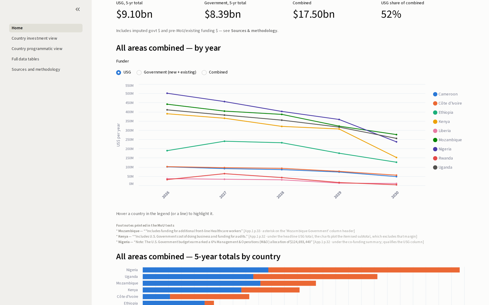

# USG MoU dashboard

**Live app:** https://usg-mou.streamlit.app/ · **Standalone explorer:** https://tafmeijer.github.io/USG_MOU/




Interactive dashboard tracking the **America First Global Health Strategy bilateral health
MoUs** (36 countries, five-year cooperation plans 2026–2030): who funds what, how U.S.
funding tapers while government co-financing ramps up, and the programmatic targets each
agreement commits to.

All information here is **publicly available**, amounts from the
[KFF tracker](https://www.kff.org/global-health-policy/kff-tracker-america-first-mou-bilateral-global-health-agreements/),
detailed tables transcribed from the **17 published full MoU texts**: 16 signed texts hosted by
[Public Citizen](https://www.citizen.org/article/u-s-bilateral-health-agreements-case-act-reporting/)
and Zambia's [final pre-signature draft](https://healthgap.org/wp-content/uploads/2026/10/Final-Draft-MOU-Zambia.docx.pdf) posted by Health GAP, with [Health Policy Watch](https://healthpolicy-watch.news/) and
[Think Global Health](https://www.thinkglobalhealth.org/article/tracking-the-america-first-bilateral-health-agreements)
as secondary mirrors.

## How each text became public

Public Citizen's table marks every agreement with the route by which its text reached the
public, and the distinction is part of the story:

| Marker | Meaning | Countries |
|---|---|---|
| `*` | The U.S. government made the text public itself, via its **Case Act reporting page** | Uganda only |
| `*^` | Published on the Case Act page **and** released under FOIA | Kenya, Mozambique, Nigeria, Ethiopia, Malawi |
| `^` | Public **only** because of Public Citizen's **Freedom of Information Act** requests | Rwanda, Liberia, Lesotho, Eswatini, Cameroon, Sierra Leone, Botswana, Madagascar, Côte d'Ivoire, Burundi |
| none | Released by **neither government**: the final pre-signature draft, posted by Health GAP and linked from Public Citizen's table | Zambia |

Ten of the seventeen public texts, and six of the seven countries added in September 2026,
exist in the public record only because Public Citizen sued the State Department for them. The
August 2026 production (FL-2026-00021) is what that litigation yielded. Both the marker and a
plain-language description are carried per country in `data/countries.csv`
(`Disclosure marker`, `How the text became public`), and 19 of the 36 signed agreements still
have no public text at all.

## Pages

| Page | What it shows |
|---|---|
| **Home (Overview)** | All 17 countries side by side, per investment area, yearly trajectories as a grey field with a **clickable country list** (ordered by 2026 size) that draws the chosen country in colour, plus full-term totals and a **US$ ↔ % of combined** toggle |
| **Country investment view** | One country's small multiples across every investment area, with a USG / Govt (existing + new) / Both toggle and the same $/% toggle; the country name links to the source PDF |
| **Investment area view** | The transpose: pick one investment area and see the global USG/government split for it, every country ranked by commitment, and one small multiple per country ordered largest to smallest |
| **Country programmatic view (v0)** | One country's indicator baselines & 2026–2030 targets (outcome / process / 7-1-7), each indicator as its own small chart |
| **Full data tables** | The complete budget and programmatic datasets across all countries, filterable, sortable, searchable, downloadable |
| **Sources & methodology** | Every link (trackers, mirrors, all 36 agreements), extraction method, and caveats |

`explorer.html` is a standalone, dependency-free version of the trajectory explorer,
open it directly in a browser, no Python needed. `docs/index.html` is the copy GitHub Pages
serves; both are regenerated from `data/budget_series.csv` by
`analysis/rebuild_explorer_data.py`.

## Theming

The app ships light **and** dark themes (`.streamlit/config.toml`); Streamlit's default
setting ("Use system setting") follows the browser/OS colour-scheme preference, and users
can still override it in the app menu. Explicit chart colours track the active theme via
`mou_lib.palette()` (`st.context.theme`), so donut strokes, centre labels, chip legends and
the handful of dark-adjusted series colours switch with it.

## Run locally

```bash
pip install -r requirements.txt
streamlit run Home.py
```

## Publish

1. Push this folder to a public GitHub repository:
   ```bash
   git init
   git add .
   git commit -m "USG MoU dashboard"
   git branch -M main
   git remote add origin https://github.com/<you>/mou-dashboard.git
   git push -u origin main
   ```
2. Deploy free on [Streamlit Community Cloud](https://share.streamlit.io): *New app* →
   pick the repo → main file `Home.py`. Every push to `main` redeploys automatically.

## Data

| File | Contents |
|---|---|
| `data/budget_series.csv` | Aggregated, safely summable series (Country × Investment area × Year × Funder), feeds all budget charts |
| `data/budget_tidy.csv` | Full line-item detail as printed in each MoU, with `Row type` flags (subtotals, appendix breakdowns, existing funding), source notes, and the MoUs' own printed footnotes transcribed verbatim (`MoU footnote (verbatim)` / `MoU footnote location`) |
| `data/programmatic_tidy.csv` | Every Section-1 indicator: baseline + yearly targets, units, value types, source notes, and the MoUs' own printed footnotes (verbatim + location) |
| `data/countries.csv` | All 36 agreements: announced amounts (KFF tracker), dates, program areas, source-PDF links, plus `MoU USG (USD)` / `MoU co-financing (USD)` / `MoU basis note`, what each of the 17 public texts prints in its own co-funding summary, which differs from the headline for 12 of them |
| `data/sources.csv` | Reference trackers and mirrors |
| `data/strategic_areas.csv` | Strategic-investment domains/areas named in every MoU's §2.6, with printed prices and page references |
| `analysis/` | Derived analyses: $/FTE imputation scripts and outputs, cadre-table harvests (Mozambique, Uganda), baseline valuations, analysis notes |

**Summing rules** (see Sources & methodology page in the app): only `Row type = "Line item"`
rows plus existing-government rows are summed; the MoUs' own subtotals, nested appendix
breakdowns, FTE headcounts and domestic-expenditure pledges are excluded to avoid double
counting. "Government" = new co-financing **plus** existing funding where tabulated
(Nigeria, Ethiopia, Rwanda publish no existing split, their shares are understated).

## Provenance & caveats

**Read this before using the data.** All figures were transcribed from the sixteen signed
MoU texts in the public domain, released by the U.S. government via its Case Act reporting
page, or under Public Citizen's FOIA requests, and mirrored by Public Citizen, Health Policy
Watch and Think Global Health, from Zambia's final pre-signature draft (posted by Health GAP;
its amounts match the signed deal as announced), and from the KFF tracker. The MoUs are
government-to-government cooperation documents that were **not originally drafted for
publication**; no official consolidated dataset of them exists, and this repository is an
independent research reconstruction. In particular:

1. **Amounts are plans, not obligations.** By the MoUs' own terms they are not
   international agreements and all activities are *subject to the availability of funds*.
   Nothing here represents appropriations, disbursements, or current implementation status,
   and the published scans may have been amended or superseded since.
2. **Figures are transcribed as printed**, including source-document errors (misprinted
   totals, conflicting appendices, internally inconsistent tables). These are preserved
   uncorrected and flagged in the `Source note` column.
3. **Derived values are clearly separated from printed ones.** Rows flagged
   `Imputed (derived - not printed in MoU)` / `Imputed baseline (pre-MoU - derived)` and
   series with `Basis` other than "Printed in MoU" are estimates produced by this
   project's documented methodology (FTE commitments priced at unit rates derived from
   the same documents), they are never printed values, they carry stated confidence
   ranges, and every chart lets you toggle them off. See the app's *Sources &
   methodology* page and `analysis/` for full derivations.
4. Tables were machine-transcribed from the source PDFs and independently verified
   against them. Compiled August 2026; Zambia added October 2026. **Not an official product of any government or
   organisation**, and no affiliation with any party to the MoUs is implied. Content is
   provided as-is for research and transparency purposes; corrections are welcome via
   issues or pull requests.

## License

Code and derived data are released under the [MIT License](LICENSE). The underlying MoU
texts remain the work of their authors; transcription here is for research and
transparency purposes.

## Changelog

### October 2026: Zambia

Zambia signed on 8 October 2026, after a ten-month delay over a linked critical-minerals
deal. The only public text is Health GAP's **"Final Draft"** (https://healthgap.org/wp-content/uploads/2026/10/Final-Draft-MOU-Zambia.docx.pdf),
linked from Public Citizen's table: its signature block is blank ("SIGNED at [INSERT CITY] on
[DATE]"). It is included, unlike South Sudan's April draft, because its amounts are the signed
deal's as announced: U.S. $1,516,265,000 ("more than $1.5 billion"), a $975M cumulative
domestic-spending increase (Table 5.1) and ~$154M of new co-financing (App. 1 Table 3). The
executed text may differ in wording: specimen-sharing provisions were reportedly removed at
signing, while the draft's §2.1.2 still plans "a specimen sharing arrangement". Public full
texts go from 16 to **17 of 36**; the KFF tracker also added Vietnam (11 Sep 2026, U.S.
$98.75M, no text, co-financing unclear).

**Added:** Zambia's Appendix 1 budget (all seven U.S. lines; government New / Existing /
Total for five areas), App. 2 commodity detail, Section-1 indicators (12 outcome, 16 process,
7-1-7) and §2.6 strategic areas, via `analysis/add_zambia_oct2026.py` (idempotent).

**Pattern breaks worth knowing about:**

- **The U.S. headline exceeds its own itemised table** by $207.2M (11–17% a year, no
  footnote), so it is not the usual 6% M&O wedge. The charts plot the line items.
- **The government prices its existing workforce in dollars**, like Botswana: App. 1's
  $2.11bn government column holds a $283.7M-a-year worker bill ($1.42bn over the term) and
  only $153.6M of new co-financing. Zambia alone more than doubles the dataset's
  printed-existing government $ (~$1.62bn to ~$3.31bn).
- **One government worker line** ("Healthcare Workers & CHW"): its lab share is carved out
  pro-rata by the printed FTE mix, as for Uganda and Eswatini. Nothing is imputed.
- **CHW-heavy.** 84% of the 40,422 U.S.-funded FTEs in 2026 are community workers (21,216
  CHWs/volunteers, 12,876 seasonal malaria workers). Three different U.S. FTE totals are
  printed (40,422 / 37,756 / 36,461); App. 1's is used.
- **A 1:1 funding cut** for a domestic-spending shortfall, where most MoUs say 2:1.

### September 2026: the FOIA release

Public Citizen published the State Department's FOIA production (FL-2026-00021) on
30 August 2026. Public full texts went from 9 to **16 of 34**.

**Added:** Lesotho, Eswatini, Sierra Leone, Botswana, Madagascar, Malawi, Burundi, full
budget appendices, Section-1 indicator tables and §2.6 strategic areas.

**Re-sourced:** Rwanda, Liberia, Cameroon and Côte d'Ivoire now point at the official
release rather than a third-party mirror. Rwanda, Liberia and Cameroon are numerically
identical to the earlier copies (Rwanda was diffed word by word, no change).
**Côte d'Ivoire gained three Appendix 1 rows** that were illegible in the earlier scan:
Frontline Lab Workers $ ($2.1M), Frontline Healthcare Workers $ ($31.7M) and Management &
Operations $ ($29.2M), lifting its itemised U.S. total from $423.6M to $486.7M against a
printed $487.2M.

**South Sudan is still excluded**, the only available text is a pre-signature April 2026
draft; the agreement was signed on 25 June 2026 and its final text is not public.

**Pattern breaks worth knowing about:**

- **Botswana runs 2026–2028**, not 2026–2030. Its headline is not comparable to the others
  without adjusting for term length.
- **Botswana's U.S. line items do not reconcile** to its own printed totals in any year
  (−$3.6M over the term), the only published MoU where the U.S. side fails to add up.
- **Burundi and Côte d'Ivoire print the 6% management-and-operations carve-out** as its own
  Appendix 1 line; elsewhere it is a silent gap (Lesotho, Madagascar and Botswana all sit
  exactly 6% below their headline).
- **The Appendix 1 government tables are mislabelled.** They are headed "total *new*
  planned financial support" but carry the §2.x.3 **Total Government Funding** column,
  new plus existing. True of the original nine as well.
- **Three new texts disagree with the KFF tracker**: Malawi ($744.8M/$55.0M vs
  $792M/$143.8M), Eswatini ($192.7M vs $205M) and Botswana ($99.6M vs $106M, exactly 6%).

**Build scripts.** `data/budget_tidy.csv` and `data/programmatic_tidy.csv` are the
hand-transcribed source of truth; everything else is derived. After any change under
`data/`, regenerate and check in the same commit:

```bash
python3 analysis/fte_rate_imputation_all.py && python3 analysis/impute_new_countries.py && python3 analysis/apply_imputation_to_dashboard.py && python3 analysis/rebuild_budget_series.py && python3 analysis/rebuild_explorer_data.py && python3 analysis/validate_data.py
```

The first two recompute the imputed and pre-MoU-baseline government rows; the next two
regenerate `data/budget_series.csv` and the JSON snapshot embedded in `explorer.html` /
`docs/index.html`. `analysis/validate_data.py` then re-checks the invariants the dataset
rests on, aggregates against their parts, series against tidy, `countries.csv`
arithmetic, the explorer snapshot, the totals quoted on the methodology page, and the
programmatic `Direction` / `Qualifier` columns. Skip the imputation steps if only
printed figures changed. **Known issue (Oct 2026):** since the cumulative-FTE convention,
`fte_rate_imputation_all.py` computes Uganda's absorbed-cohort continuation as zero and
drops its $122.8M of imputed rows (the validator fails on it), so the committed
`analysis/imputed_*.csv` files are the reference; start the chain at
`apply_imputation_to_dashboard.py` until that is fixed. `analysis/extract_aug2026_release.py` covers the indicator rows
and provenance refresh for the August 2026 release.
